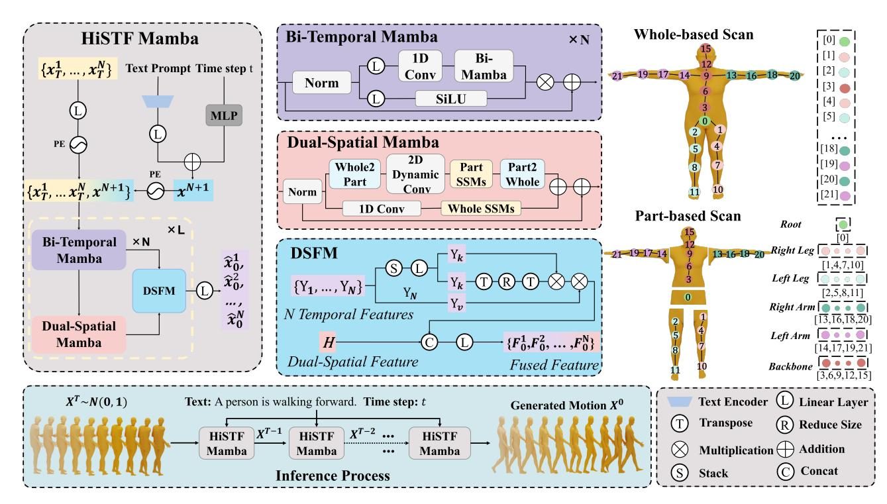

<!-- BEGIN GENERATED PAPER HEADER -->
# HiSTF Mamba — ICME 2026

**Linear Multi-granular Body Modeling for Text-Driven Motion Generation**

Xingzu Zhan, Genpei Zhang, Chen Xie, Honghang Chen, Haoran Sun, Xiaochun Mai

**Accepted by ICME 2026.**
[Paper](https://arxiv.org/abs/2503.06897) · [Code](https://github.com/chorl0229/HiSTFmamba) · [Citation](#citation) · [Setup](docs/SETUP.md) · [Training and evaluation](docs/USAGE.md)
<!-- END GENERATED PAPER HEADER -->

HiSTF Mamba combines part-based and whole-body spatial modeling, bidirectional temporal modeling, and dynamic spatiotemporal fusion for text-driven motion generation.



## Getting started

1. Follow [installation and data preparation](docs/SETUP.md) to create a dedicated CUDA environment.
2. Check [artifact availability](weights/README.md) and prepare the inputs for your task.
3. Run the example below, or follow the dataset-specific commands in the [usage guide](docs/USAGE.md).

**Pretrained models:** a checkpoint matching the archived HiSTF/DSFM architecture is not yet available. Training and inference entry points are included; pretrained evaluation requires recovery of the matching checkpoint and configuration. The current reconstructed configuration differs from the paper's reported parameter count; see [implementation status](docs/SOURCE_AUDIT.md).

```bash
# After installing dependencies and preprocessing HumanML3D:
python src/train.py data=hml3d_light_final \
  trainer.devices=2 trainer.precision=bf16-mixed trainer.max_epochs=350
```

This is the documented six-temporal-block reconstruction. Its relationship to the
paper configuration is described in the [usage guide](docs/USAGE.md).
Evaluation and generation commands in that guide require a matching checkpoint.

## Results and reproducibility

The paper reports **FID 0.039 on HumanML3D** and **0.217 on KIT-ML**. These are paper-reported results. The source reconstruction has not reproduced them.

See the [model card](MODEL_CARD.md), [validation record](docs/MAINTENANCE_VALIDATION.md),
and [paper-to-code map](docs/ARCHITECTURE.md) for supported inputs, tested components,
and implementation details. [Source provenance](docs/SOURCE_AUDIT.md) records known
differences between the archived code and paper.

## Repository guide

```text
src/models/     Denoiser, spatial/temporal modules, and diffusion wrapper
src/data/       Dataset loading and motion representations
src/train.py    Training entry point
src/eval.py     Evaluation entry point
configs/        Hydra data, model, sampler, and trainer configurations
third_party/    Custom Mamba and causal-conv1d backends
tools/          Validation, citation synchronization, and release packaging
tests/          CPU regressions and maintenance-tool tests
docs/           Setup, usage, architecture, and provenance
weights/        Artifact availability manifest
```

Legacy Python module names and checkpoint keys are retained for compatibility.
Each repository needs its own environment because the vendored Mamba implementations differ.

## Development

```bash
python -m pip install -r requirements-dev.txt
python tools/maintain.py
```

The full check also requires PyTorch and NumPy. Use `--static` for documentation
and source checks without the model dependencies. See [contributing](CONTRIBUTING.md)
and [release preparation](docs/RELEASE.md) for the maintenance workflow.
CPU checks do not validate CUDA kernels or benchmark scores.

## Citation

If you use this work, please cite the conference paper.
[CITATION.cff](CITATION.cff) supports GitHub's citation UI; [CITATION.bib](CITATION.bib)
provides a downloadable BibTeX entry.

<!-- BEGIN GENERATED CITATION -->
```bibtex
@inproceedings{zhan2026histfmamba,
  title = {Linear Multi-granular Body Modeling for Text-Driven Motion Generation},
  author = {Zhan, Xingzu and Zhang, Genpei and Xie, Chen and Chen, Honghang and Sun, Haoran and Mai, Xiaochun},
  booktitle = {2026 IEEE International Conference on Multimedia and Expo (ICME)},
  year = {2026},
  url = {https://arxiv.org/abs/2503.06897},
  note = {Accepted at ICME 2026}
}
```
<!-- END GENERATED CITATION -->

## Acknowledgments and license

The implementation builds on [Light-T2M](https://github.com/qinghuannn/light-t2m), [Vision Mamba](https://github.com/hustvl/Vim),
[Mamba](https://github.com/state-spaces/mamba), and the
[HumanML3D](https://github.com/EricGuo5513/HumanML3D) / text-to-motion ecosystem.

Author-owned contributions use the [MIT license](LICENSE). Upstream components retain
their licenses; see [third-party notices](THIRD_PARTY_NOTICES.md). Datasets and evaluator
assets have separate terms.
